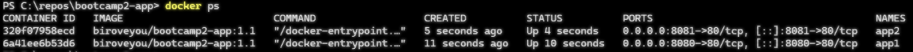

# SWAPI Search

## Autor
Daniel Macêdo Passos — Matrícula 22611324

## Descrição
Digita o nome de um personagem de Star Wars e a aplicação busca e mostra os dados dele. Foi feito principalmente pra treinar fetch com API pública em JavaScript puro, mas serve pra qualquer um que quiser ver esse fluxo funcionando na prática. Escolhi não fazer sobre o pokemon para testar se os mesmos conhecimentos podiam ser aplicados a outras APIs.

Na Etapa 02 a aplicação ganhou banco de dados (Supabase): dá pra salvar personagens como favoritos, e as buscas feitas ficam registradas. Também é distribuída como imagem Docker no Docker Hub.

## APIs e serviços utilizados
- SWAPI - The Star Wars API: https://swapi.dev/documentation
  - `GET /api/people/` — lista paginada de personagens (usada na construção do índice de nomes)
  - `GET /api/people/{id}/` — detalhes do personagem específico achado
- Supabase — banco PostgreSQL com API REST, usado para a persistência: https://supabase.com/docs

## Persistência
**Banco escolhido:** Supabase (PostgreSQL na nuvem), acessado pelo navegador com a biblioteca `supabase-js` usando a URL do projeto e a chave pública (`anon`). Os dados ficam no banco, e não no navegador, então continuam lá depois de fechar a página e aparecem iguais no GitHub Pages e no container Docker.

**O que é salvo:**
- os personagens que o usuário marca como favoritos
- cada busca feita (o termo digitado e se o personagem foi encontrado ou não)

**Estrutura das tabelas** (o SQL completo está em [`schema.sql`](schema.sql)):

Tabela `favoritos`

| Coluna | Tipo | Para quê |
|---|---|---|
| `id` | bigint, identidade, chave primária | identificador do registro |
| `criado_em` | timestamptz, padrão `now()` | quando foi salvo (ordena a lista) |
| `personagem_id` | int, **unique** | id do personagem na SWAPI (impede favoritar duas vezes) |
| `nome` | text | nome exibido na lista |
| `ano_nascimento` | text | dado exibido na lista |
| `genero` | text | usado no painel de estatísticas |

Tabela `historico`

| Coluna | Tipo | Para quê |
|---|---|---|
| `id` | bigint, identidade, chave primária | identificador do registro |
| `criado_em` | timestamptz, padrão `now()` | quando a busca foi feita |
| `termo` | text | o que foi digitado |
| `encontrado` | boolean | se o personagem foi achado |

**Segurança (RLS):** ativada nas duas tabelas. Para o papel `anon`: `select`, `insert` e `delete` em `favoritos`; `select` e `insert` em `historico`. Nada de `update`.

**Operações:** criar (salvar favorito, gravar busca), listar (favoritos e últimas buscas) e excluir (remover favorito), todas pela interface.

## Funcionalidades
- Buscar um personagem pelo nome (ou início do nome) digitado na barra de busca
- Visualizar
  - altura (`person.height`)
  - massa (`person.mass`)
  - ano de nascimento (`person.birth_year`)
  - gênero (`person.gender`)
  - cor de cabelo (`person.hair_color`)
  - cor dos olhos (`person.eye_color`)
  - quantidade de filmes do personagem encontrado (`person.films.length`)
- Salvar o personagem nos favoritos, listar os favoritos e remover
- Botão **Random** (versão 1.1): sorteia um personagem entre todos os da SWAPI e mostra os dados dele, sem repetir o que já está na tela
- Extra: histórico das últimas 5 buscas (clicar em uma refaz a busca; as sem resultado aparecem com borda tracejada)
- Extra: painel de estatísticas dos favoritos (total, mais recente e gênero mais comum, calculados a partir do banco)
- Feedback de status durante o carregamento da lista e da busca
- Tratamento de erros: personagem não encontrado, API fora do ar, favorito duplicado e falha do banco

## Como executar

### No navegador (sem instalar nada)
Acesse: https://biroveyou.github.io/bootcamp2-app/

### Com Docker (um comando)
```
docker run -d -p 8080:80 biroveyou/bootcamp2-app:1.1
```
Depois abra http://localhost:8080

### Localmente a partir do código
1. Clone: `git clone https://github.com/biroveyou/bootcamp2-app` (Uso do HTTPS)
2. Abra o arquivo `index.html` no navegador

## Sidequests

### SQ1 · .dockerignore
O arquivo [`.dockerignore`](.dockerignore) na raiz do repositório fica assim:

```
.git
.gitignore
README.md
schema.sql
evidencias
Dockerfile
.dockerignore
```

O `Dockerfile` usa `COPY . /usr/share/nginx/html`, que copia tudo da pasta para dentro da imagem. Sem o `.dockerignore`, iria junto o `.git` (todo o histórico do repositório, que pode ser maior que o próprio site), o README, o SQL das tabelas e os prints, e nada disso é usado pelo nginx. Ignorar esses arquivos deixa a imagem menor e evita expor arquivos internos no site servido. O build também fica mais rápido: o Docker envia a pasta inteira como "contexto de build" antes de construir, então um contexto menor é enviado mais rápido, e mudar um arquivo ignorado (como o README) não invalida o cache da camada do `COPY`.

### SQ2 · Versionamento de imagem
O repositório no Docker Hub tem três tags:

| Tag | Descrição |
|---|---|
| `1.0` | primeira versão funcional (persistência com Supabase) |
| `1.1` | adiciona o botão **Random**, que sorteia e mostra um personagem aleatório da SWAPI |
| `latest` | aponta para a versão mais recente (1.1) |

```
docker pull biroveyou/bootcamp2-app:1.1
```

### SQ3 · Descrição no Docker Hub
O Overview do repositório (https://hub.docker.com/r/biroveyou/bootcamp2-app) explica o que é a aplicação, traz o comando `docker run` pronto para copiar e o link do repositório no GitHub.

### SQ4 · Explorando a orquestração
Rodei dois containers ao mesmo tempo, em portas diferentes (8080 e 8081):

```
docker run -d -p 8080:80 --name app1 biroveyou/bootcamp2-app:1.1
docker run -d -p 8081:80 --name app2 biroveyou/bootcamp2-app:1.1
docker ps
```



**"Se eu tivesse 100 containers, como gerenciaria?"**

Subir e acompanhar 100 containers na mão, com `docker run` e `docker ps`, não dá: eu teria que iniciar cada um, ver quais caíram, reiniciar, espalhar em várias máquinas e trocar a versão um por um. É para isso que existe o Kubernetes, um orquestrador de containers. Ele funciona em um *cluster*, que é um conjunto de máquinas (os nós) coordenado por um plano de controle. A menor unidade que ele gerencia é o *pod*, que agrupa um ou mais containers que rodam juntos. Em vez de eu iniciar cada container, eu descrevo o estado que quero (por exemplo, "100 réplicas da imagem `biroveyou/bootcamp2-app:1.1`") e o Kubernetes mantém esse número: se um pod cai, ele cria outro; se preciso de mais ou menos, só mudo a quantidade de réplicas; e ele distribui os pods entre os nós. Um *Service* dá um endereço único e divide as requisições entre as réplicas, e a atualização de versão pode ser feita aos poucos (*rolling update*), sem derrubar a aplicação.

## Links
- **Aplicação no ar (GitHub Pages):** https://biroveyou.github.io/bootcamp2-app/
- **Repositório:** https://github.com/biroveyou/bootcamp2-app
- **Imagem no Docker Hub:** https://hub.docker.com/r/biroveyou/bootcamp2-app